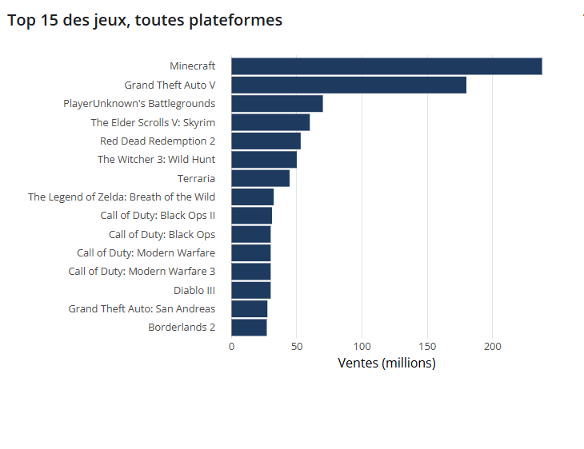

## Les jeux vidéo : ventes et éditeurs

Ce dashboard présente les jeux vidéo les plus vendus et les principaux éditeurs du marché. Il permet de comparer les ventes et de voir quels jeux ont rencontré le plus de succès.

Sur la gauche, des filtres permettent de choisir les années de sortie et les genres de jeux, comme l’action, l’aventure ou le sport. En haut, on retrouve quelques chiffres clés : 10 791 millions de ventes au total, 20 471 jeux avec des ventes connues et Wii Sports comme jeu le pus vendu selon les données du dashboard.

Au centre, le graphique classe les 15 jeux les plus vendus. Minecraft arrive en première position avec environ 238 millions de ventes, suivi de Grand Theft Auto V avec environ 180 millions. On remarque un écart important entre ces deux jeux et le reste du classement. D’autres titres connus, comme PUBG, Skyrim et Red Dead Redemption 2, figurent également parmi les jeux les plus vendus.

À droite, le classement des éditeurs place Rockstar Games en tête, devant Electronic Arts et Capcom. Ubisoft et Activision font aussi partie des éditeurs présentés. Ce graphique permet de comparer les ventes des différentes entreprises et de voir lesquelles se démarquent.

Les onglets en haut de la page permettent également d’explorer d’autres aspects du jeu vidéo, notamment les critiques, les franchises et les jeux phares.

Pour conclure, ce dashboard offre une vue d’ensemble du marché du jeu vidéo. Les graphiques et les filtres facilitent la lecture des données et permettent de comparer les jeux et les éditeurs. On voit ainsi que certains titres, notamment Minecraft et Grand Theft Auto V, se démarquent nettement par leurs ventes.

